<h1 align="center">Hey, I'm Fea 👋</h1>

<p align="center">
  
</p>

<p align="center">
  Infrastructure admin: servers, storage, networks, backups.<br>
  Every project below started the same way: I needed a tool, couldn't find one that did <i>just that</i>, so I wrote it.
</p>

<p align="center">
  
</p>

---

## 🧰 Things I built

<table>
  <tr>
    <td width="50%" valign="top">
      <h3>🧩 <a href="https://github.com/Feareis/Orphan">orphan</a></h3>
      <b>The bus factor, made concrete.</b><br>
      Lists the files only one person really knows, ranked by risk. Reads git history only, so it works on any repo, code or infra.<br><br>
      <code>pipx install orphan</code>
    </td>
    <td width="50%" valign="top">
      <h3>🚋 <a href="https://github.com/Feareis/greline">greline</a></h3>
      <b>Grenoble's trams & buses, live on a map.</b><br>
      Every vehicle moving along its real route, next departures, disrupted sections. Next.js + MapLibre on open data.<br><br>
      <a href="https://greline.app">greline.app ↗</a>
    </td>
  </tr>
  <tr>
    <td width="50%" valign="top">
      <h3>🛡️ <a href="https://github.com/Feareis/Detress">Detress</a></h3>
      <b>Lightweight network detection & response.</b><br>
      Packet metadata capture (Scapy), a rule engine (FastAPI) and a small dashboard. Built for SOC training and blue-team labs.
    </td>
    <td width="50%" valign="top">
      <h3>🧪 <a href="https://github.com/Feareis/Nodrift">NoDrift</a></h3>
      <b>Semantic versioning for LLM prompts.</b><br>
      Compares two prompt versions section by section and flags behavioral drift (<code>ok</code> / <code>warning</code> / <code>breaking</code>) before it ships.
    </td>
  </tr>
</table>

---

## 🖥️ What I run

```yaml
systems:  [Debian, Ubuntu, Windows Server, VMware vSphere, Proxmox]
storage:  [HPE Alletra, NetApp, Synology, Veeam]
network:  [VLAN, routing, DNS, firewalls, VPN/IPsec, HAProxy, Nginx, Apache]
code:     [Python, Bash, PowerShell, TypeScript, PHP, Node.js, React, C#]
ops:      [Docker, PostgreSQL, Supabase, Grafana, Centreon, ITIL]
```

## 🎓 Certifications


## 🔭 Now

<!-- Keep this list short and concrete; update it every month or two. -->
- 🔨 Working on: **greline** and **orphan**
- ⚙️ Automating: the boring parts of my day-to-day ops work
- 📚 Learning: <!-- e.g. Ansible, Terraform, Kubernetes… -->

---

<p align="center">
  <picture>
    <source media="(prefers-color-scheme: dark)" srcset="https://raw.githubusercontent.com/Feareis/Feareis/output/snake-dark.svg" />
    <source media="(prefers-color-scheme: light)" srcset="https://raw.githubusercontent.com/Feareis/Feareis/output/snake.svg" />
    
  </picture>
</p>
